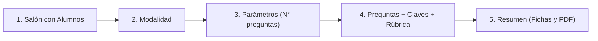

# Manual de Operación y Arquitectura del Sistema Microevaluación

Este documento constituye la **fuente de verdad canónica y única** para el funcionamiento pedagógico, técnico y operativo del sistema Microevaluación, tanto para el docente como para el asistente inteligente (EVA).

---

## 1. Principio Fundacional: Salones y Alumnos

### 1.1. Regla Inmutable: «No existe salón sin alumnos»
* En Microevaluación, **un salón requiere obligatoriamente al menos un (1) estudiante registrado** en su nómina.
* **Queda terminantemente prohibido crear salones vacíos (0 alumnos).**
* Si un docente solicita crear un salón sin proporcionar nombres, el sistema y el asistente DEBEN detenerse y exigir la lista de alumnos antes de registrar el aula en la base de datos.

### 1.2. Justificación Técnica y Física
* El sistema genera fichas de evaluación impresas **nominales y personalizadas**.
* Cada ficha física impresa contiene:
  1. El nombre y número de orden del estudiante.
  2. Un **código QR individual** que codifica su ID único encriptado.
  3. Los 4 marcadores perimetrales ArUco para la alineación milimétrica por cámara.
* **Consecuencia:** Si un salón no tiene alumnos registrados, el generador de fichas (`card-generator.js`) no tiene estudiantes a quienes imprimirles fichas, el visor de PDF queda en blanco y el escáner de alta velocidad no puede evaluar a nadie.

---

## 2. Las Tres (3) Modalidades de Evaluación

El sistema ofrece tres ramas de evaluación claramente diferenciadas y aisladas:

| Modalidad | Preguntas | Formato Físico | Tipo de Corrección | Análisis de Procedimiento |
| :--- | :---: | :---: | :---: | :---: |
| **Rama 1: Formativa con IA** | 1 a 2 | Ficha A5 (Horizontal / Vertical) | IA (Gemini 2.5 Flash) | **Sí**, rúbrica cualitativa en cuadrícula de cálculo |
| **Rama 2: Focalizada** | 1 a 5 | Ficha A5 (1-2 preg) / A4 (5 preg) | Determinista Rápida (OMR o Clave) | **No**, valida respuesta final o alternativa marcada |
| **Rama 3: Cartilla OMR** | 6 a 20 | Cartilla A5 / A4 (Burbujas) | Determinista Instantánea (OMR Local) | **No**, visión computacional sobre burbujas marcadas |

---

### Rama 1: Formativa con IA (1 a 2 Preguntas)
* **Objetivo Pedagógico:** Diagnóstico profundo del aprendizaje. Evalúa el razonamiento matemático paso a paso del alumno.
* **Componentes de la Ficha:**
  * Enunciado de la pregunta.
  * Opciones múltiples A, B, C, D (si es de alternativas) o consigna abierta con franja manuscrita `Rpta: _______` (Respuesta Libre).
  * **Cuadrícula de cálculo (borrador manuscrito):** Espacio amplio donde el estudiante realiza sus cálculos a mano.
* **Corrección:**
  * La cámara fotografía la cuadrícula de cálculo.
  * La IA (Gemini) analiza la imagen, coteja los pasos contra la solución canónica, detecta errores conceptuales típicos y califica según una rúbrica ponderada (*Logro Esperado*, *En Proceso*, *En Inicio*).

---

### Rama 2: Focalizada en la Respuesta (1 a 5 Preguntas)
* **Objetivo Pedagógico:** Verificación rápida de respuestas clave o habilidades puntuales sin necesidad de calificar el borrador.
* **Componentes de la Ficha:**
  * 1 o 2 preguntas en ficha A5; hasta 5 preguntas en hoja A4.
  * Cada pregunta tiene sus 4 alternativas (A, B, C, D) o una casilla de respuesta directa.
  * Cuadrícula de cálculo opcional de respaldo visual.
* **Corrección:**
  * 100% determinista y local (algoritmo OMR).
  * No consume llamadas a la IA para calificar, garantizando velocidad y ahorro de cuota en el aula.

---

### Rama 3: Cartilla OMR (6 a 20 Preguntas)
* **Objetivo Pedagógico:** Pruebas masivas, simulacros o exámenes de unidad de alta velocidad.
* **Dos Sub-Modalidades:**
  1. **Modo A (Solo Cartilla):**
     * Solo se imprimen las hojas de respuestas con burbujas OMR (6, 10, 15 o 20 preguntas).
     * El docente proyecta las preguntas en la pizarra, las dicta o las reparte en hojas recicladas.
  2. **Modo B (Cartilla + Cuadernillo):**
     * Se imprimen las cartillas de burbujas junto con un **cuadernillo impreso A4** que contiene los enunciados y alternativas completas extraídas del Banco de Preguntas.
* **Corrección:**
  * Algoritmo de visión computacional local (detección de contornos y llenado de círculos negros).
  * Tiempo de respuesta por ficha: **< 100 ms**. Cero dependencia de internet durante el escaneo.

---

## 3. Secuencia Obligatoria de Creación de una Sesión

Para garantizar la coherencia del sistema y evitar errores de visualización, **toda evaluación debe transitar estrictamente por los siguientes 5 pasos en orden**:

1. **Paso 1: Salón con Alumnos**
   * El salón debe existir y tener nómina de estudiantes cargada (`students.length > 0`).
   * Si no hay alumnos, el sistema bloquea el avance.
2. **Paso 2: Modalidad de Evaluación**
   * Selección explícita entre Formativa IA (`rama1`), Focalizada (`rama2`) o Cartilla OMR (`rama3`).
3. **Paso 3: Parámetros Dimensionales**
   * Cantidad de preguntas según los límites de la modalidad.
4. **Paso 4: Contenido Pedagógico y Rúbrica (Guardarraíl Regla 6)**
   * Toda pregunta debe incluir: enunciado, 4 alternativas con su clave correcta, y su análisis pedagógico / rúbrica completa de IA.
5. **Paso 5: Vista de Preparación (Resumen y Generación de Fichas)**
   * Se renderiza el visor con las fichas personalizadas y listas para imprimir (PDF).
   * **Estado inicial:** La sesión llega como **Borrador Activo**. **NO SE GUARDA AUTOMÁTICAMENTE** en los cupos de sesiones permanentes.
   * El docente decide si pulsa `[ 💾 Guardar Sesión ]` (para almacenarla en sus 8 cupos) o si va directo a `[ 📷 Ir al Escáner ]`.

---

## 4. Banco de Preguntas y Guardarraíl de Integridad

### 4.1. Requisitos para guardar una pregunta en el Banco (Regla 6)
Para que una pregunta ingrese al Banco de Preguntas, DEBE contener obligatoriamente:
1. Enunciado claro y contextualizado.
2. Las cuatro alternativas completas (A, B, C, D) con la clave correcta marcada.
3. Solución canónica paso a paso.
4. Criterios de evaluación ponderados (*Logro Esperado*, *En Proceso*, *En Inicio*).
5. Errores conceptuales previsibles del estudiante.

* **Prohibición absoluta:** No se permite guardar preguntas sin alternativas, sin clave o sin análisis de IA bajo ninguna circunstancia.

### 4.2. Filtrado y Grado Pedagógico
* Las preguntas se organizan por etapa (Primaria / Secundaria) y grado oficial habilitado en el sistema (`GRADE_CATALOG` en `classroom-data.js`):
  * **Primaria:** 4°, 5° y 6° de Primaria (los grados 1°, 2° y 3° no están habilitados en el sistema).
  * **Secundaria:** 1°, 2°, 3°, 4° y 5° de Secundaria.
* En el banco de preguntas del Hub, solo se muestran preguntas compatibles con el grado del salón seleccionado.

---

## 5. Gestión de Cupos y Sesiones Guardadas

* **Capacidad Máxima:** El sistema permite almacenar hasta **8 sesiones guardadas simultáneas** en memoria local y nube Supabase.
* **Propósito:** Permitir al docente tener listas sus evaluaciones de diferentes salones (ej. 4° A, 5° B, 6° A) antes de entrar al aula sin conexión.
* **Borrado Sincronizado (Regla 8):** Al eliminar una sesión guardada, se libera automáticamente un cupo (`x/8`), se limpia la memoria del escáner y se actualiza la interfaz en tiempo real.

---

## 6. Reglas de Comportamiento del Asistente Interactivo (EVA)

Cuando el docente interactúe con el chat interactivo, EVA debe seguir estas directrices:

1. **Si el docente pregunta cómo funciona algo:**
   * Responder con precisión pedagógica y técnica basándose exclusivamente en este manual.
   * Ser claro, directo y no asumir datos inexistentes.
2. **Si el docente intenta crear un salón:**
   * Exigir la lista de alumnos. **PROHIBIDO crear salones con 0 alumnos.**
3. **Si el docente intenta evaluar un salón:**
   * Verificar que el salón tenga alumnos. Si tiene 0 alumnos, avisar al docente y guiarlo a cargar la nómina primero.
4. **Si el docente prepara una evaluación asistida:**
   * Respetar los 5 pasos obligatorios.
   * Conducir la sesión hacia la vista de preparación como **borrador**, sin auto-guardarla forzosamente en los 8 cupos.

---

## 7. Guardarraíles de Protección de Salones y Estudiantes

Para garantizar la validez de las fichas impresas y la integridad de los resultados históricos, el sistema aplica una separación estricta entre ediciones cosméticas y estructurales:

### 7.1. Edición Cosmética (Siempre Permitida)
* **Alcance:** Corrección ortográfica o tipográfica de nombres completos (`fullName`) y nombres cortos (`shortName`) mediante el botón **✏️ Editar**.
* **Comportamiento:** Como los códigos e identificadores internos del alumno (`student_code` / `id`) no cambian, las fichas físicas ya impresas en papel y los resultados ya registrados en la base de datos se mantienen 100% válidos.

### 7.2. Edición Estructural (Bloqueada con Guardarraíl si hay Sesión Activa o Guardada)
Si un salón se encuentra vinculado a una evaluación en curso o a cualquiera de las **8 Sesiones Guardadas**, el sistema bloquea preventivamente las siguientes acciones:
1. **Eliminar salón:** Bloqueado en el Gestor de Salones, en el asistente EVA y en el constructor.
2. **Eliminar alumno:** En la lista de estudiantes, el botón de papelera se sustituye por un candado `🔒` y la función rechaza la eliminación con una advertencia explicativa.
3. **Sobrescribir nómina por Excel/CSV:** Si el docente intenta importar un archivo sobre un aula en uso, el sistema bloquea el reemplazo para evitar desfasar los códigos QR de las fichas impresas.

---

## 8. Política de Cuotas Diarias de Inteligencia Artificial (Límites por Nivel)

Para proteger la cuota de la API de Gemini, evitar interrupciones de servicio y fomentar un uso planificado y pedagógico en el aula, el sistema implementa un esquema de cuotas diarias segmentado en tres (3) niveles independientes:

| Nivel | Función | Límite Diario | Criterio de Consumo y Alternativa al Agotarse |
| :--- | :--- | :---: | :--- |
| **Nivel 1** | **Consultas con IA en Chat (EVA)** | **15 consultas / día** | Solo descuenta cuando se llama a Gemini. Navegación local (*«abrir salones»*, *«ir al banco»*) es ilimitada y gratuita. |
| **Nivel 2** | **Generador de Rúbricas** | **6 rúbricas / día** | Cada rúbrica queda guardada permanentemente en el banco para reutilizarla todo el año sin costo adicional. |
| **Nivel 3** | **Formativa con IA (Trazos manuscritos)** | **2 sesiones completas / día** | Corrige la cuadrícula manuscrita de los alumnos. Al agotarse, el docente puede usar la *Cartilla OMR* (corrección 100% local e ilimitada). |

### 8.1. Buffer Visual del Chat (Tope de 25 Mensajes)
* **Gestión de pantalla:** El cajón del chat mantiene visibles únicamente los **últimos 25 mensajes** en el DOM. Al ingresar un mensaje número 26, el mensaje más antiguo del inicio se retira suavemente de pantalla.
* **Beneficio:** Mantiene el scroll ligero, rápido y sin saturar la memoria del navegador en jornadas extensas, preservando suficiente contexto para releer explicaciones recientes.

### 8.2. Reinicio Automático de Cuotas
* Las cuotas se calculan por fecha calendario local (`YYYY-MM-DD`).
* Todos los contadores de cuota se restablecen a cero de forma automática cada día a las **00:00 (medianoche)**.

