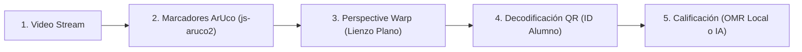

# SPEC-05: Escáner Óptico y Visión Computacional

* **Versión:** 1.0.0
* **Estado:** Aprobada
* **Módulos de Código:** `scanner.js`, `roi-processor.js`, `aruco.bundle.js`, `jsqr.min.js`
* **Fuente Canónica:** `MANUAL_SISTEMA.md` (Sección 2), `AGENTS.md` (Reglas 8, 9 y 11)

---

## 1. Propósito Pedagógico y Técnico

El escáner es el punto de contacto más sensible del docente: opera en el aula física, sosteniendo el teléfono con una mano sobre el pupitre mientras pasa hojas impresas con la otra. Exige **cero fricción, latencia ultrabaja (< 100 ms) y tolerancia a sombras, inclinaciones y variaciones de luz**.

---

## 2. Pipeline de Detección Óptica

El flujo de procesamiento de cada fotograma de cámara sigue 5 etapas secuenciales:

1. **Detección de Marcadores ArUco:** Localiza los 4 vértices del papel (IDs 0, 1, 2, 3) y calcula el cuadrilátero perimetral expandido.
2. **Perspective Warp (Rectificación Plana):** Transforma la imagen inclinada en un lienzo plano de alta resolución con relación de aspecto milimétrica idéntica al original físico.
3. **Lectura de Código QR:** Extrae del encabezado el ID encriptado del alumno y verifica que pertenezca a la nómina del salón activo.
4. **Extracción de Regiones de Interés (ROIs):**
   * *Si es OMR:* Evalúa la densidad de píxeles oscuros en cada burbuja de alternativa para determinar la opción marcada.
   * *Si es Formativa IA:* Recorta la cuadrícula de cálculo completa a máxima resolución para enviarla al analizador pedagógico.

---

## 3. Reglas Inmutables y Guardarraíles

1. **Resiliencia de Aula (Regla 9 · Cero Bloqueo del Docente):**
   * El ritmo de escaneo en el aula **NUNCA debe ser congelado por la IA**.
   * Si la llamada a Gemini supera el timeout de 4 segundos o hay desconexión:
     - El escáner **JAMÁS congela la pantalla** ni bloquea el visor.
     - La captura se almacena localmente con estado `Pendiente de análisis IA`.
     - La cámara se desbloquea de inmediato para continuar con el siguiente estudiante.
2. **No-Invasión del Clasificador Local (Regla 11 · INT8 Gatekeeper):**
   * Cualquier clasificador local rápido solo actúa como filtro de cuadrícula vacía o borrador sin trazos. **NUNCA penaliza ni califica el procedimiento matemático**: ante duda o baja certeza, delega la imagen íntegra a Gemini.
3. **Anti-Duplicación en Vivo:** Una vez evaluado un estudiante, el escáner ignora re-capturas accidentales durante la misma pasada en el aula, mostrando feedback verde inmediato.

---

## 4. Criterios de Aceptación (Verificables)

* `CRIT-SCN-01`: **Tiempo de Respuesta OMR (< 100 ms)**
  * *Dado* una cartilla OMR (Rama 2 o 3) con los 4 marcadores ArUco visibles
  * *Cuando* la cámara enfoca la hoja
  * *Entonces* la detección, el warp, la lectura de QR y la asignación de puntaje deben resolverse en menos de 100 milisegundos.

* `CRIT-SCN-02`: **Timeout y Desbloqueo Inmediato (4 segundos)**
  * *Dado* una captura formativa con IA en condiciones de baja conectividad
  * *Cuando* la respuesta de la nube tarde más de 4000 ms
  * *Entonces* el sistema debe guardar el borrador en estado pendiente y reactivar la cámara de inmediato sin emitir alertas bloqueantes.

* `CRIT-SCN-03`: **Alineación Robusta ante Inclinación**
  * *Dado* una ficha presentada con perspectiva inclinada de hasta 35° respecto a la cámara
  * *Cuando* los 4 marcadores ArUco sean detectados
  * *Entonces* el algoritmo de perspective warp debe rectificar la imagen sin distorsión geométrica en las casillas OMR.
